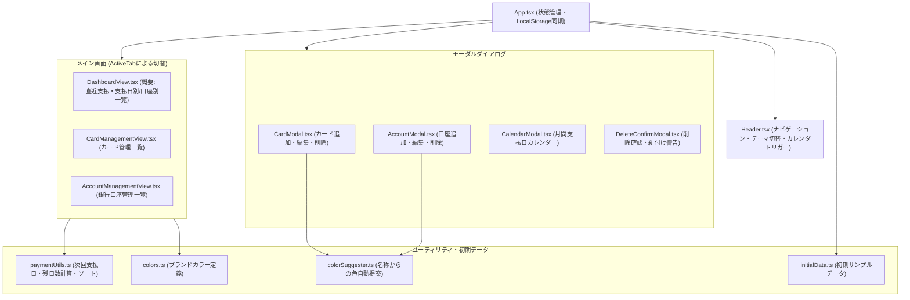
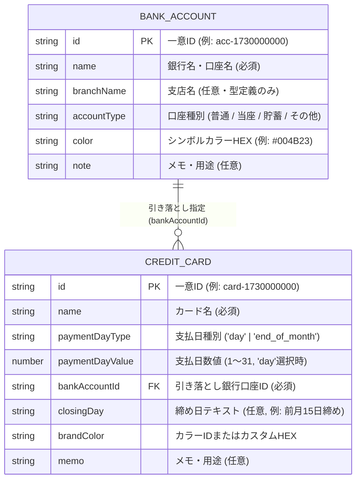

# クレジットカード・口座支払日管理 システム仕様書（現状版）

## 1. アプリケーション概要

| 項目 | 内容 |
| :--- | :--- |
| **アプリ名** | クレジットカード・口座支払日管理（カード＆口座引き落とし管理） |
| **目的** | 複数のクレジットカードの支払日（引き落とし日）と、それに紐づく引き落とし銀行口座を一元管理・可視化するWebアプリケーション |
| **ターゲット** | 複数のクレジットカードと銀行口座を使い分けており、毎月の引き落とし日・口座残高準備を把握したい個人ユーザー |
| **デザインテーマ** | Google Flat Design Theme（ダークモード / ライトモード切替対応、レスポンシブ対応） |
| **プロジェクトパス** | [2026-07-31-16-58-11](file:///C:/AI_google/newappidea/2026-07-31-16-58-11) |

---

## 2. システムアーキテクチャ・技術スタック

### 2.1 技術スタック
* **フロントエンドフレームワーク**: React 19 (`react@^19.0.1`, `react-dom@^19.0.1`) + TypeScript (`~5.8.2`)
* **ビルドツール**: Vite 6 ([vite.config.ts](file:///C:/AI_google/newappidea/2026-07-31-16-58-11/vite.config.ts))
* **スタイリング**: Tailwind CSS v4 (`@tailwindcss/vite@^4.1.14`)
* **アイコン**: Lucide React (`lucide-react@^0.546.0`)
* **データ永続化**: ブラウザ `localStorage`（バックエンド通信・外部DB・外部API通信なし）

> [!NOTE]
> [package.json](file:///C:/AI_google/newappidea/2026-07-31-16-58-11/package.json) には AI Studio のテンプレート由来の `@google/genai` や `express` が含まれていますが、現在のソースコード内では一切使用されておらず、**完全なクライアントサイドSPA（シングルページアプリケーション）**として動作します。

### 2.2 コンポーネント構成図

---

## 3. データモデル・ストレージ仕様

### 3.1 型定義（[types.ts](file:///C:/AI_google/newappidea/2026-07-31-16-58-11/src/types.ts)）

### 3.2 LocalStorage キー仕様（[App.tsx](file:///C:/AI_google/newappidea/2026-07-31-16-58-11/src/App.tsx#L13-L15)）

| 用途 | キー名 | 初期値（未保存または空配列時） |
| :--- | :--- | :--- |
| **カード一覧データ** | `card_payment_manager_cards_v1` | [`INITIAL_CREDIT_CARDS`](file:///C:/AI_google/newappidea/2026-07-31-16-58-11/src/data/initialData.ts#L27-L66)（4件のサンプル） |
| **銀行口座一覧データ** | `card_payment_manager_accounts_v1` | [`INITIAL_BANK_ACCOUNTS`](file:///C:/AI_google/newappidea/2026-07-31-16-58-11/src/data/initialData.ts#L3-L25)（3件のサンプル） |
| **表示テーマ設定** | `card_payment_manager_theme_v1` | `'dark'`（ダークモード） |

---

## 4. 画面・機能仕様

### 4.1 ヘッダーバー（[Header.tsx](file:///C:/AI_google/newappidea/2026-07-31-16-58-11/src/components/Header.tsx)）
* **タブナビゲーション**:
  * **「概要」タブ** (`dashboard`): 登録カード枚数バッジ付き。
  * **「カード」タブ** (`cards`): クレジットカード管理画面へ切替。
  * **「口座」タブ** (`accounts`): 登録口座数バッジ付き。
* **アクションボタン**:
  * **テーマ切替ボタン**: ダークモード（`dark` クラス付与）とライトモードを即時切替。
  * **「カレンダー」ボタン**: 月間支払日カレンダーモーダルを起動。

### 4.2 概要（ダッシュボード）画面（[DashboardView.tsx](file:///C:/AI_google/newappidea/2026-07-31-16-58-11/src/components/DashboardView.tsx)）
1. **直近の引き落としハイライトバナー**:
   * 全登録カードの中で「次回支払日までの残り日数（`daysLeft`）」が最小のカード1件を最上部に強調表示。
   * カウントダウン表示（当日：`本日引き落とし！`、翌日：`明日引き落とし`、それ以降：`あと N 日`）。
   * カード名または口座バッジをクリックすると、それぞれの編集モーダルを直接起動可能。
2. **表示コントロールバー**:
   * **グルーピング切替**: 「支払日別 (`date_sort`)」と「口座別 (`bank_group`)」の2モード切替。
   * **「詳細」トグルスイッチ** (`showDetails`): コンパクト表示と詳細表示の切替。
3. **一覧表示モード**:
   * **支払日別 × コンパクト表示（デフォルト）**: 同じ支払日（例：`毎月 4日 引き落とし`、`毎月末日 引き落とし`）ごとにグループ化し、カード名と引き落とし口座バッジをシンプルに一覧表示。
   * **支払日別 × 詳細表示**: 各カードごとに支払日バッジ、締め日、口座バッジ、メモ、残り日数バッジ（5日以内はアンバー警告色、当日はエメラルド点滅）、編集・削除アイコンを表示。
   * **口座別表示**: 登録されている銀行口座ごとにセクションを作成し、その口座から引き落とされるカードを支払日順に表示。

### 4.3 クレジットカード管理画面（[CardManagementView.tsx](file:///C:/AI_google/newappidea/2026-07-31-16-58-11/src/components/CardManagementView.tsx)）
* 「管理クレジットカード枚数」と「連携引き落とし口座数」のサマリーボックスを表示。
* 「＋ クレジットカードを追加」ボタン。
* 登録済みカード一覧（ブランドカラーの左ボーダー付きカードリスト、締め日・口座・メモの表示、編集・削除ボタン）。

### 4.4 銀行口座管理画面（[AccountManagementView.tsx](file:///C:/AI_google/newappidea/2026-07-31-16-58-11/src/components/AccountManagementView.tsx)）
* サマリーボックスと「＋ 銀行口座を追加」ボタン。
* 口座カードをグリッド表示（1〜3列レスポンシブ）。
* 各口座に紐づいているクレジットカードの件数（`N Cards`）とカード名タグ一覧を表示。

### 4.5 モーダル機能
1. **カード登録・編集モーダル（[CardModal.tsx](file:///C:/AI_google/newappidea/2026-07-31-16-58-11/src/components/CardModal.tsx)）**
   * 入力項目：カード名（必須）、支払日設定（毎月1〜31日 または 毎月末日）、引き落とし銀行口座（必須、モーダル内から新規口座追加へ遷移可能）、締め日（任意）、カードカラー（プリセット12色＋カスタムカラーピッカー）、メモ（任意）。
   * 編集時は左下に「削除する」ボタンを表示。
2. **銀行口座登録・編集モーダル（[AccountModal.tsx](file:///C:/AI_google/newappidea/2026-07-31-16-58-11/src/components/AccountModal.tsx)）**
   * 入力項目：銀行名/口座名（必須）、口座種別（普通・当座・貯蓄・その他）、シンボルカラー（プリセット12色＋カスタムカラーピッカー）、メモ（任意）。
3. **支払日カレンダーモーダル（[CalendarModal.tsx](file:///C:/AI_google/newappidea/2026-07-31-16-58-11/src/components/CalendarModal.tsx)）**
   * 月送り（前月・翌月・今月へ戻る）対応の7列カレンダーグリッド。
   * 引き落としがある日付セルには件数バッジ（`N件`）と対象カードのカラードット（最大3つ＋`+N`）を表示。
   * 日付セルをクリックすると、下部の「引き落とし詳細」エリアにその日の対象カードと引き落とし口座を表示。
4. **削除確認モーダル（[DeleteConfirmModal.tsx](file:///C:/AI_google/newappidea/2026-07-31-16-58-11/src/components/DeleteConfirmModal.tsx)）**
   * カードまたは口座の削除時に確認ダイアログを表示。
   * **口座削除時の安全設計**: 削除対象の口座に紐づいているカードが存在する場合、「現在 N 枚のカード（〇〇）の引き落とし口座に指定されています。削除するとカード側の口座指定が解除されます。」という警告メッセージを表示。

---

## 5. ビジネスロジック詳細

### 5.1 支払日ソート＆次回支払日計算（[paymentUtils.ts](file:///C:/AI_google/newappidea/2026-07-31-16-58-11/src/utils/paymentUtils.ts)）
* **ソート順**: 毎月指定日（`1`〜`31`）を昇順で並べ、月末（`end_of_month` = ランク `32`）を最後に配置。同日の場合はカード名の日本語辞書順（`localeCompare`）。
* **次回支払日 (`getNextPaymentDate`)**:
  * 今日の日付（`today`）がカードの支払日以前であれば「当月の支払日」（小の月で31日指定などの場合は当月末日に丸める）。
  * 今日の日付が支払日を過ぎていれば「翌月の支払日」を算出。
  * ※土日祝日の翌営業日補正は行わず、設定された暦日ベースで計算する仕様。

### 5.2 ブランドカラー自動提案ロジック（[colorSuggester.ts](file:///C:/AI_google/newappidea/2026-07-31-16-58-11/src/utils/colorSuggester.ts)）
カード名や銀行名の入力文字列をリアルタイム解析し、日本の主要ブランドに合ったテーマカラーを自動適用＆提案バナー表示します。
* **カード名の自動判定（19パターン）**:
  * ゴールド (`gold`)、プラチナ/ブラック (`slate`)、Suica/ビュー/JR (`teal`)、三井住友/SMBC/Olive (`emerald`)、楽天 (`rose`)、PayPay (`rose`)、JCB (`indigo`)、イオン (`fuchsia`)、エポス (`rose`)、dカード/ドコモ (`amber`)、au/povo (`orange`)、AMEX (`cyan`)、セゾン (`blue`)、Yahoo (`rose`)、メルカリ (`purple`)、ライフ (`orange`)、オリコ (`slate`)、三菱UFJ/ニコス (`rose`)、みずほ (`blue`)。
* **銀行名の自動判定（15パターン）**:
  * 三井住友 (`#004B23`)、三菱UFJ (`#BF0000`)、みずほ (`#003399`)、ゆうちょ (`#FF6600`)、りそな (`#10B981`)、楽天 (`#BF0000`)、住信SBI (`#0284C7`)、PayPay (`#FF0033`)、ソニー (`#0F766E`)、SBI新生 (`#D97706`)、イオン (`#EC4899`)、あおぞら (`#0EA5E9`)、セブン (`#16A34A`)、メルペイ (`#6B21A8`)、ローソン (`#0284C7`)。

---

## 6. コード解析で見つかった今後の改善ポイント（公開前の検討事項）

現在のコードは非常に丁寧に作られていますが、一般公開・実運用に向けて以下の軽微な改善点が見つかりました（ご希望であれば私の方ですぐに修正可能です）。

> [!IMPORTANT]
> 1. **すべてのカード・口座を削除した際のリセット挙動（[`App.tsx` 45〜69行目](file:///C:/AI_google/newappidea/2026-07-31-16-58-11/src/App.tsx#L45-L69)）**
>    * 現在、`localStorage` 読み込み時に `parsed.length > 0` という条件があるため、ユーザーが初期サンプルのカードや口座をすべて削除して0件にしたあとページを再読み込みすると、**初期サンプルデータ（ビックカメラSuicaなど）が復活してしまう**仕様になっています。
> 2. **「口座別」表示での詳細トグル連動（[`DashboardView.tsx` 539行目〜](file:///C:/AI_google/newappidea/2026-07-31-16-58-11/src/components/DashboardView.tsx#L539)）**
>    * 概要タブの「詳細」スイッチは現在「支払日別」表示のときのみ切り替わり、「口座別」表示のときは常に同じ表示になっています。また、どの口座にも紐づいていない（口座削除後などの）カードが「口座別」モードで表示されないため、「口座未設定」グループがあるとより親切です。
> 3. **不要なパッケージの整理（[`package.json`](file:///C:/AI_google/newappidea/2026-07-31-16-58-11/package.json)）**
>    * 未使用の `@google/genai`, `express`, `dotenv`, `motion` などを整理すると、ビルドやGitHub連携がさらに軽くなります。
